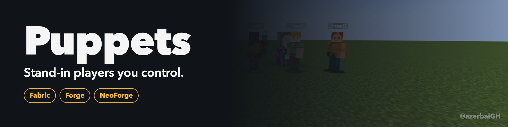
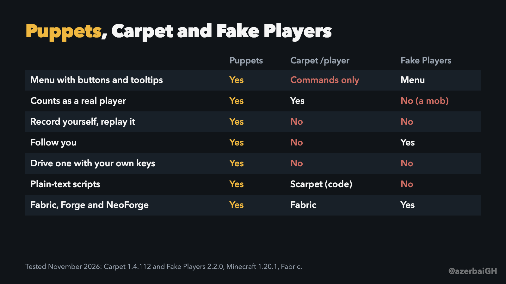
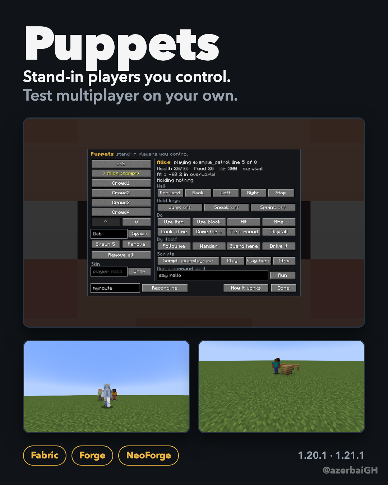
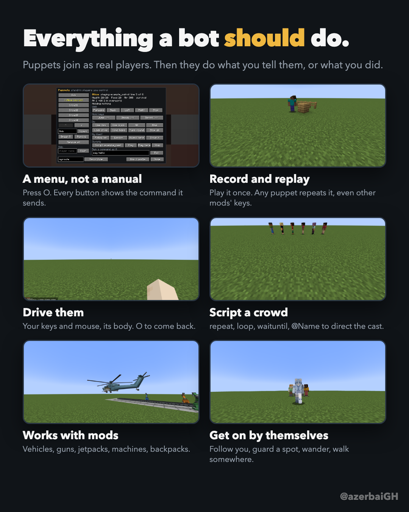
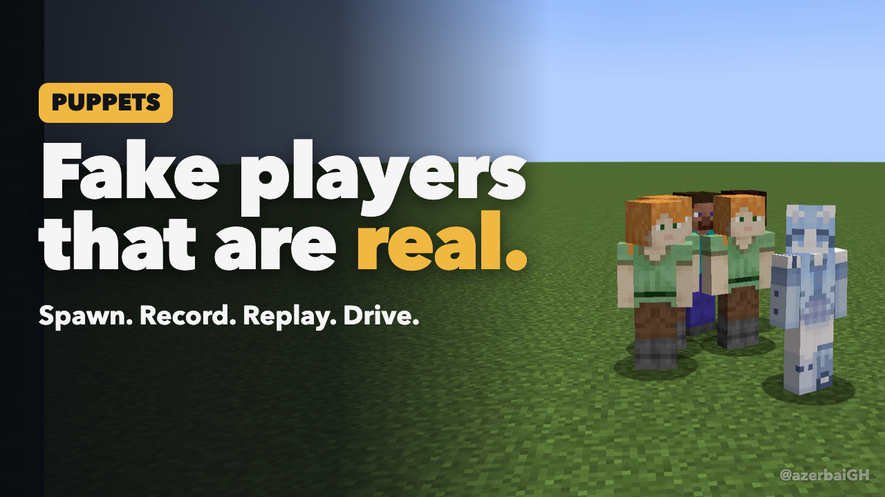
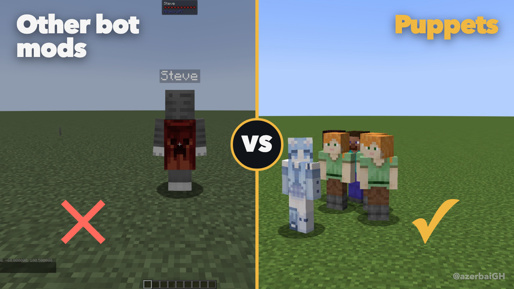
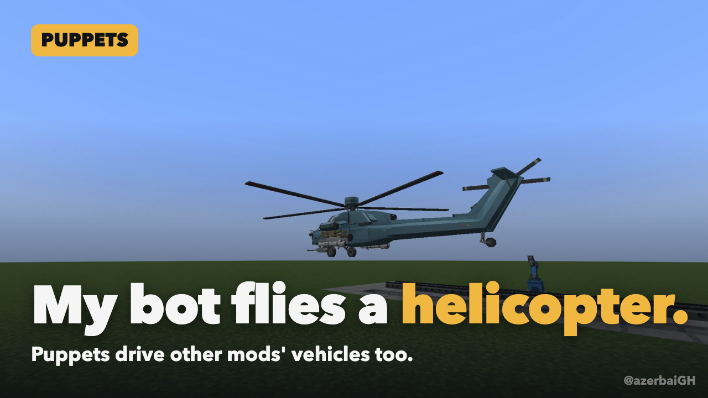
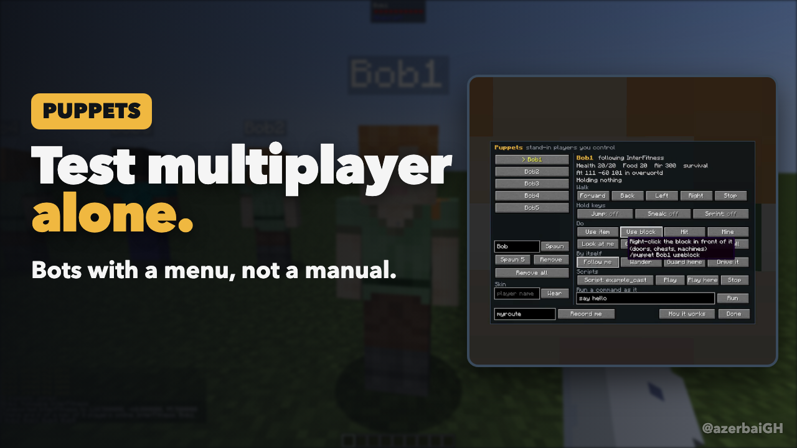
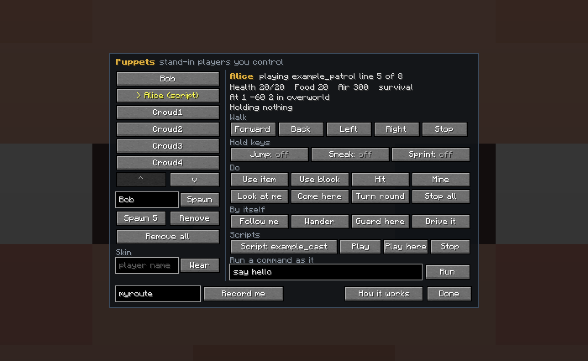
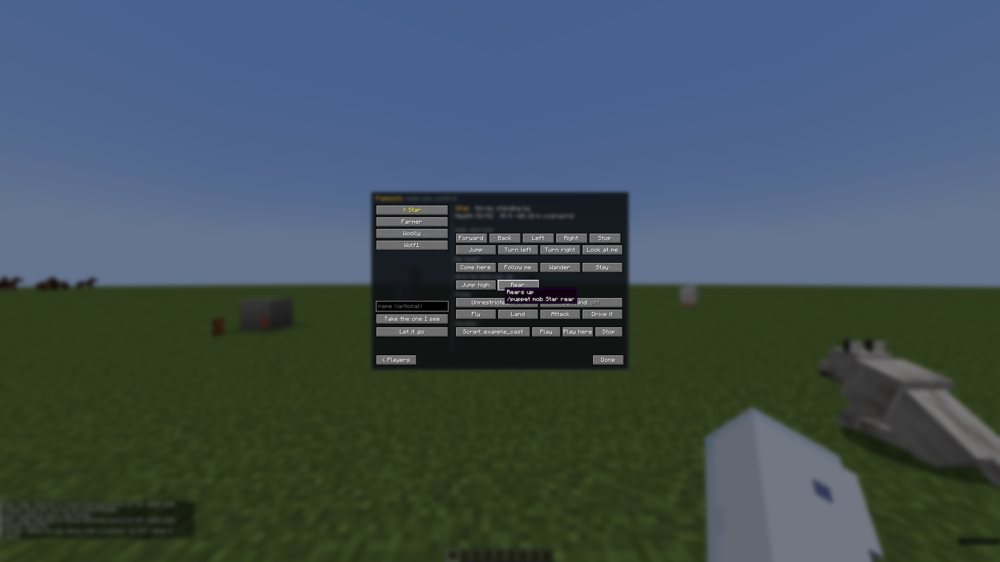

# Puppets

**Stand-in players you control.** Test anything multiplayer on your own: spawn real players, tell them what to do, record yourself and have them replay it, or take one over and drive it with your own keys. Mobs too.

By [@azerbaiGH](https://twitter.com/azerbaiGH). Fabric, Forge and NeoForge.



| Minecraft | Loaders |
| --- | --- |
| 1.20.1 | Fabric, Forge |
| 1.21.1 | Fabric, Forge, NeoForge |
| 1.21.11 | Fabric, NeoForge |

Only the server needs Puppets. Install it in your own game too for the menu and for driving puppets.

**Contents:** [What it does](#what-it-does) · [What only Puppets does](#what-only-puppets-does) · [Comparison](#compared-with-other-fake-player-mods) · [Media](#media) · [Changelog](CHANGELOG.md)

---

## What it does

### Puppets are real players
A puppet joins the server as a real player, not a mob dressed as one. It shows in the tab list and `/list`, counts for `@a` and anything else that counts players, takes damage, drowns, gets hungry, sleeps, rides things, is saved like a player, and keeps its inventory.

### A menu, not a manual
Press **O** for the Puppets menu. Spawn one puppet or five, pick one, and press buttons: walk, hold jump, sneak or sprint, use, hit, mine, follow you, wander, guard, play a script, run a command as it. Every button's tooltip shows the `/puppet` command it sends, so you learn the commands as you go. Everything also works by command, with tab completion.

### Record yourself, replay with any puppet
`Record me`, play it out, `Stop`. Any puppet replays it: walking, looking, building, digging, opening chests, clicking in machines, crafting, trading, writing signs, driving vehicles. It records what your game sends the server, including **other mods' own packets byte for byte**, so it replays mod keys and buttons (vehicle controls, gun triggers, machine buttons) for mods Puppets has never heard of. Replay where it was recorded, or `relative` to start from where the puppet stands.

### Plain-text scripts
Scripts are text files, one action per line, in the spirit of AutoHotkey:
```
repeat 4
  move forward
  wait 1s
  turn right
end
goto ~5 ~ ~
waituntil idle
@Alice say Bob's back!
```
`wait`, `repeat`, `loop`, `waituntil idle|health < 10`, `@Name` to direct other puppets (or mobs) from one script, `log`, `stop`. A bad line is skipped and logged, never a crash.

### Drive one yourself
**Possess** a puppet: your keys and mouse move it and you see through its eyes. Walk, jump, mine, fight, use items, swap hands, open screens. Press **O** to come back to your own body.

**Drive together:** if someone's already driving, you join them. Your keys add up, it looks wherever whoever moved their mouse last is looking, and clicks come from anyone. When the main driver lets go, the next one takes over.

**Watch:** ride along behind its eyes without driving (`/puppet Bob watch` or the menu's Watch button).

### Jobs
Give a puppet a job and it works like a player would: `miner` (digs out ores, tunnelling to ones it can't see), `quarry` (digs out an area, top layer first), `lumberjack` (fells trees, replants), `farmer` (harvests, resows, tills by water), `courier` (chest to chest), `fisher` (real rod, reels in on a bite), `crafter` (one recipe at a crafting table, over and over). It uses real tools at their real speed (they wear down), only digs what it can see, eats when hungry, empties its pockets into a chest when they're full, picks up its drops, and stops and tells you why when it runs out of something. Pick one on the menu's **Jobs** page (point at a chest before opening the menu to set it), or `/puppet Steve job miner radius 10 store 100 64 200`.

### They get on by themselves
`follow` (you, a player or a mob), `goto x y z`, `wander`, `guard` (fights monsters near its spot, then goes back), `stay`. They walk straight, jump up steps and swim.

### Mob puppets
Take over **any mob**: look at it and run `/puppet mob take`, or use the menu's **Mobs** page. Its own goals and brain stand down while it's a puppet. It walks, jumps, looks, pathfinds to a spot, follows, attacks (skeletons shoot), rides things, plays your scripts and recordings, and you can **drive it** with your own keys.

What each kind really can do, it does: horses `jump high` and `rear`, farmer villagers `harvest` and `plant` (from their own inventory), tamed pets `sit`, sheep `graze`, creepers `ignite`, endermen `pickup` and `place` blocks.

**Unrestricted** lifts the rules: any mob may place and break blocks, fly, talk in chat, hit things, run faster, teleport, and follow a recording exactly. A cow that builds and talks is one command away.

**Own mind**: hand its normal AI back while it stays a puppet.

### Everything else
- **Shadow**: `/puppet shadow` logs you off and leaves a puppet with your name, skin and gear where you stood, for AFK farms or seeing what others see of you. Log back in and you take its place.
- **Skins**: any real player's skin, kept across restarts.
- **Inventory**: open a puppet's inventory to give or take items (or sneak and right-click it); `copygear` gives it a copy of what you carry.
- **Screens**: click slots, press buttons, trade with villagers, write signs, as a player would.
- **Crowds**: `spawn Bob count 5`, `/puppet all <action>`, `/puppet group <prefix> <action>`.
- **Restarts**: puppets that were on come back where they were.
- **Mod support by name**: Superb Warfare vehicle keys, TACZ guns (shoot, reload, aim, fire mode...), Trinkets and Curios (`equip`), Rackcraft jetpacks. Everything else works through recordings.
- **For testers**: `check health|air|food|x|y|z <op> <value>` returns 1 or 0 for command blocks and scripts, with machine-readable log lines (`PUPPET_CHECK`, `PUPPET_SCRIPT DONE`, `PUPPET_ARRIVED`).
- **For developers**: an addon API to add your own actions and behaviours or listen for puppets joining and leaving, with an example addon to fork. `PuppetsApi.spawn/act/takeMob/actMob` from your own mod.
- **Server owners**: permission level, a puppet cap, rejoin after restart and shadows are all settings. Offline-mode UUIDs from names, so puppets never clash with real accounts.
- **Light**: 100 puppets cost about 7 ms a tick in testing. Runs alongside Carpet and in a 300-mod pack.

---

## What only Puppets does

Among the fake player mods compared below, these are Puppets' alone:

1. **Record yourself and replay it** with any puppet, including other mods' own packets.
2. **Plain-text scripts** that direct several puppets (and mobs) at once.
3. **Mob puppets**: take over any mob, script it, record for it, drive it, with realistic per-kind actions and an unrestricted mode.
4. **A menu that teaches the commands**: every button shows the command it sends.
5. **Driving a puppet with your own keys** *and* scripting, recording and behaviours in the same mod (Advanced Fake Player also drives; it has no scripts, recordings or behaviours).
6. **Shadow**: leave a puppet of yourself in your place when you log off.
7. **Named mod support**: vehicle keys, gun actions, trinket/curio slots by command.
8. **Test hooks**: `check` results and log lines made for automated tests.
9. **Watch mode**: look through a bot's eyes while it works or someone else drives.

---

## Compared with other fake player mods

Checked in November 2026. Carpet and Fake Players were tested in game (Carpet 1.4.112 and Fake Players 2.2.0, Minecraft 1.20.1, Fabric). Advanced Fake Player is compared from its mod page. "Not offered" means the mod's page and our testing showed no such feature; corrections are welcome in the issues.

### The basics

| | Puppets | Carpet `/player` | Fake Players | Advanced Fake Player |
| --- | --- | --- | --- | --- |
| What a bot is | A real server player | A real server player | A mob that looks like a player | A real server player |
| Counts as a player (`/list`, tab list, `@a`) | Yes | Yes | No (tested: `/list` shows only you) | Yes |
| How you control it | Menu (O) and commands | Commands | Its own menu, items and job markers | Commands, and possession |
| Needs the mod on your game | No (menu and driving need it) | No | Yes | Yes |
| Fabric | Yes | Yes | Yes | Yes |
| Forge | Yes | No | Yes | Yes |
| NeoForge | Yes | No | Yes | Not in its supported table |
| Minecraft versions | 1.20.1, 1.21.1, 1.21.11 | 1.14 to 26.3 | 1.19.2 to 26.2 | 1.20.1 (per its table) |

### Telling it what to do

| | Puppets | Carpet `/player` | Fake Players | Advanced Fake Player |
| --- | --- | --- | --- | --- |
| Menu with buttons | Yes, each shows its command | No | Yes | No |
| Walk, look, turn | Yes | Yes | Through jobs | Through possession |
| Hold jump, sneak, sprint | Yes | Yes | No | Through possession |
| Use, attack, mine: once, held, every N ticks | Yes | Yes | No | Through possession |
| Drop, swap hands, pick a slot | Yes | Yes | No | Through possession |
| Run any command as it | Yes | No (`/execute as` works on any player) | No | No |
| Work screens: click slots, press buttons, trade, write signs | Yes | No | No | Through possession |
| Open its inventory to give or take | Yes | No | Yes (its menu) | Through possession |

### By itself

| | Puppets | Carpet `/player` | Fake Players | Advanced Fake Player |
| --- | --- | --- | --- | --- |
| Follow you | Yes | No (tested: no follow command) | Yes | Not offered |
| Go to a spot | Yes | No | Waypoints, for jobs | Not offered |
| Wander | Yes | No | Yes | Not offered |
| Guard a spot | Yes | No | Yes | Not offered |
| Automated jobs (mining, lumberjack, farming, hauling, fishing, crafting) | **Yes**, worked by a real player: real tools wearing down, tunnelling, eating, chest runs | No | **Yes**, worked by the mob | Not offered |

### Recording, scripting, driving

| | Puppets | Carpet `/player` | Fake Players | Advanced Fake Player |
| --- | --- | --- | --- | --- |
| Record yourself, replay it | **Yes** | No | No | Not offered |
| Replays other mods' keys and buttons | **Yes** | No | No | No |
| Scripts | **Plain text**, one action per line | Scarpet (a programming language) | No | Not offered |
| One script directs several bots | **Yes** (`@Name`) | With Scarpet code | No | No |
| Drive it with your own keys | **Yes** | No | No | **Yes** |
| Several players drive one bot | **Yes**: keys add up, look follows whoever turned last | No | No | Yes (beta) |
| Watch through its eyes without driving | **Yes** | No | No | Not offered |
| Drives other mods' vehicles | Yes (recorded, or Superb Warfare keys by name) | No | No | Through possession |

### Mobs

| | Puppets | Carpet `/player` | Fake Players | Advanced Fake Player |
| --- | --- | --- | --- | --- |
| Take over any mob | **Yes** | No | No | No |
| Mob scripts and recordings | **Yes** | No | No | No |
| Drive a mob | **Yes** | No | No | No |
| Real per-kind actions (horse jump, farmer harvest, enderman carry...) | **Yes** | No | No | No |
| Unrestricted mode (a cow that builds, flies and talks) | **Yes** | No | No | No |

### Everything else

| | Puppets | Carpet `/player` | Fake Players | Advanced Fake Player |
| --- | --- | --- | --- | --- |
| Skins | Any player's, kept across restarts | The account with the bot's name | By name or URL, slim and classic | By name or URL |
| Leave a bot of yourself when you log off | **Yes** (`shadow`) | Yes (`shadow`) | No | No |
| Bots come back after a restart | Yes, where they were | Depends on Carpet's settings and apps | They're entities, saved with the world | Not stated |
| Addon API for other mods | Yes, with an example addon | Scarpet | Not stated | Not stated |
| Checks for automated tests | Yes | With Scarpet | No | No |
| Technical tools (tick warp, counters, loggers) | No | **Yes**, it's Carpet's main purpose | No | No |

**In short:** Carpet is the technical player's toolkit, and its `/player` is a solid command for bots on Fabric. Fake Players makes helper NPCs that work for you. Advanced Fake Player is about possessing bots. Puppets does the testing side (real players, a menu, recording and replay, scripts, driving together, mobs) and the helper side (jobs worked by real players), on Fabric, Forge and NeoForge.



---

## Media

Everything here is free to share. Videos are 30 fps, filmed in real time in game.

### Videos
| | |
| --- | --- |
| [Trailer, landscape](media/videos/puppets-trailer-landscape.mp4) (1:19) | YouTube, the mod page |
| [Trailer, vertical](media/videos/puppets-trailer-vertical.mp4) (1:20) | Shorts, TikTok |
| [Short, vertical](media/videos/puppets-short-vertical.mp4) (0:44) | TikTok, Reels, Shorts |
| [Short, landscape](media/videos/puppets-short-landscape.mp4) (0:44) | X, Reddit |
| [Versus, vertical](media/videos/puppets-versus-vertical.mp4) (0:36) | Five rounds against Carpet and Fake Players |
| [Quick teaser, vertical](media/videos/puppets-quick-vertical.mp4) (0:23) | |

### Posters and thumbnails

 

   

The menu:  

Titles, descriptions and tweets are in [media/captions.md](media/captions.md) and [media/tweets.md](media/tweets.md).
